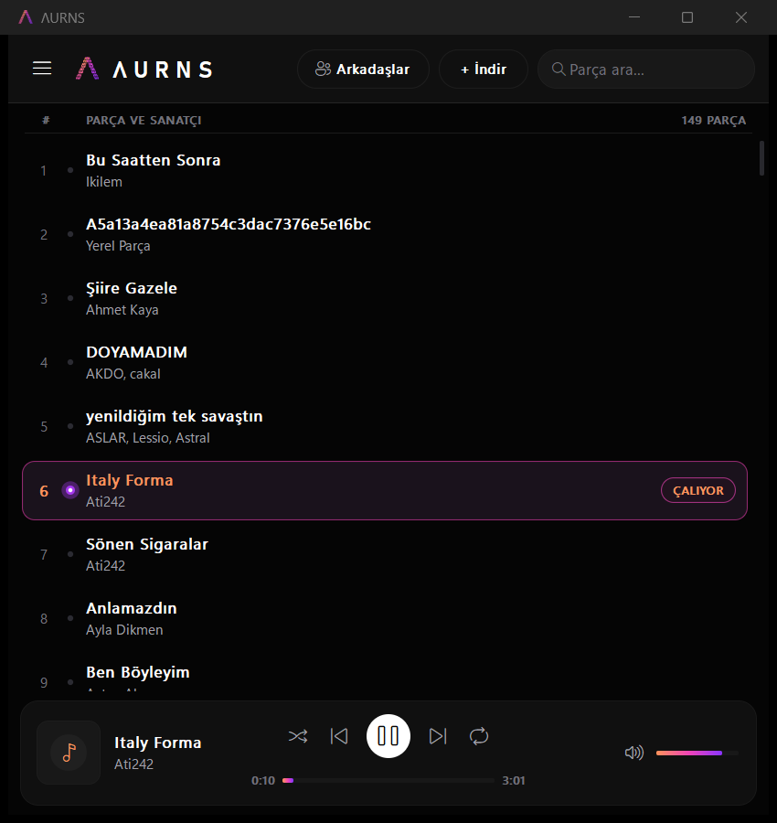
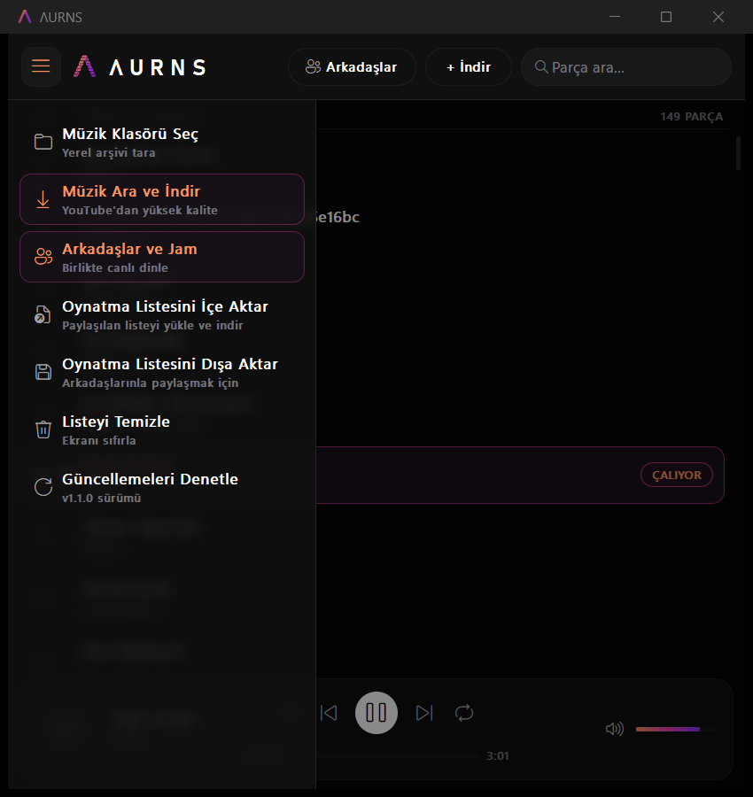
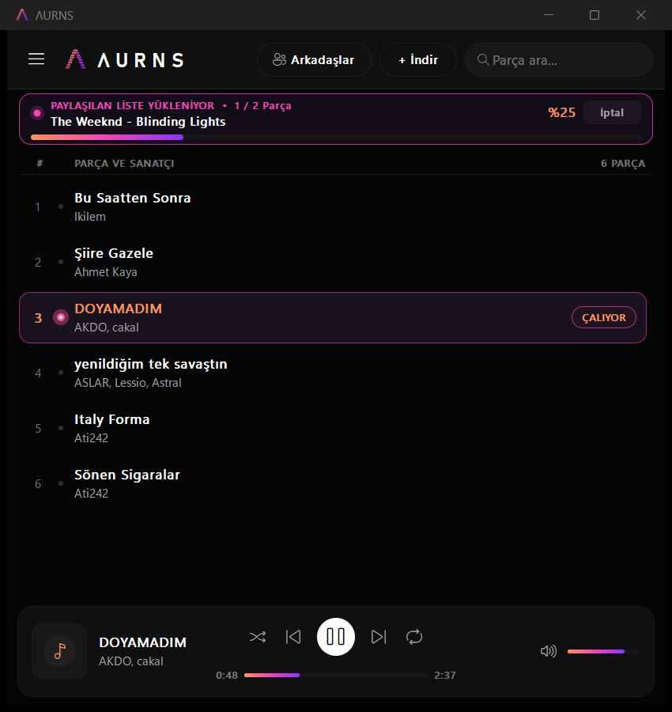
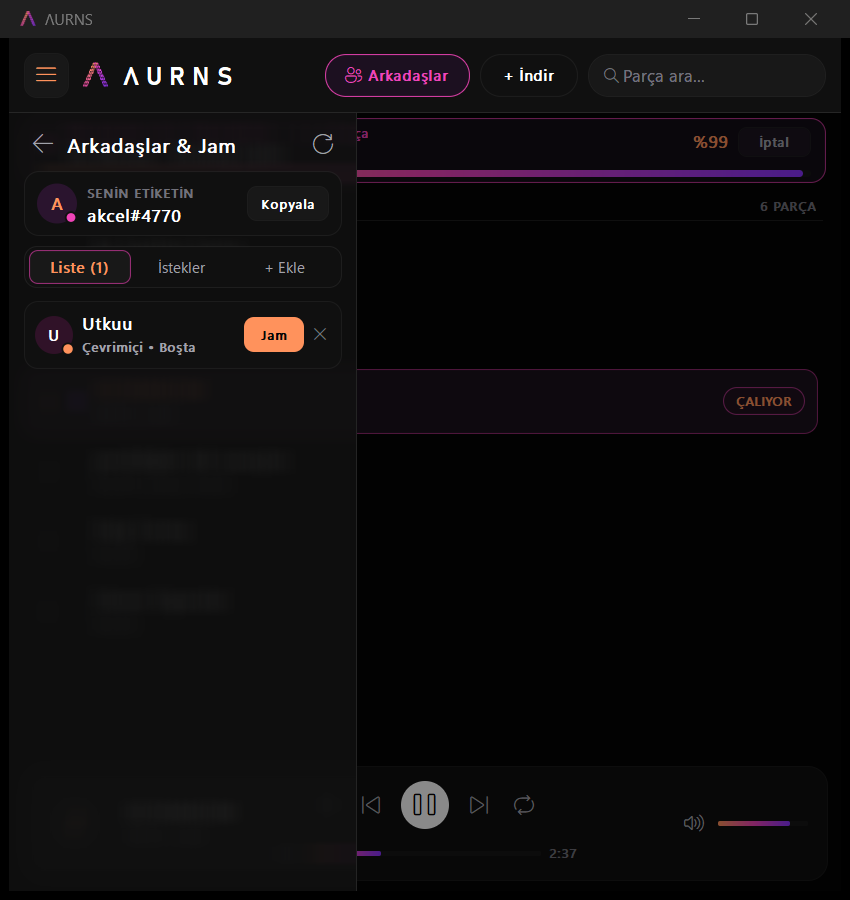

<div align="center">

  

  # Λ U R N S
  ### Ultra Hafif (0.5 MB RAM) & Saf Win32 Native Müzik Çalar
  **Apple Akıcı Yay Fiziği • Akıllı Paylaşılan Liste • Canlı P2P Jam • Dahili YouTube İndirici**

  <p align="center">
    <a href="https://github.com/selimakclk/aurns/releases/latest"></a>
    
    
    
    
    <a href="LICENSE"></a>
  </p>

  <p align="center">
    <a href="https://github.com/selimakclk/aurns/releases/latest/download/Aurns.exe">
      
    </a>
  </p>

</div>

---

## ⚡ Neden ΛURNS?

Modern masaüstü müzik oynatıcılarının çoğu **Electron** veya gömülü tarayıcı motorları (Chromium) kullanır ve boşta bile **200 MB – 800 MB** bellek tüketir. 

**ΛURNS**, hiçbir harici ağır kütüphane veya tarayıcı motoru içermeyen **saf C99 ve Win32 API** mimarisiyle sıfırdan yazılmıştır:
* **0.05 saniyede anında açılır.**
* Görev Yöneticisi'nde **yalnızca ~0.5 MB RAM** tüketir.
* Apple akışkan arayüz standartlarına sadık kalınarak geliştirilmiş **60 FPS kesintiye uğratılabilir yay fiziği** ve **buzlu cam (frosted glass)** efektleri sunar.
* P2P Canlı Jam ve otomatik şarkı indirme özellikleriyle donatılmıştır.

---

## 📸 Ekran Görüntüleri

<table align="center" width="100%">
  <tr>
    <td width="50%" align="center">
      <p><b>Obsidian & Sunset-Neon Ana Ekran</b></p>
      
    </td>
    <td width="50%" align="center">
      <p><b>Apple Buzlu Cam Menü & Oynatma Listesi</b></p>
      
    </td>
  </tr>
  <tr>
    <td width="50%" align="center">
      <p><b>Evrensel Canlı İndirme Yüzdesi ve Durum Çubuğu</b></p>
      
    </td>
    <td width="50%" align="center">
      <p><b>Canlı P2P Jam & Arkadaşlar Dinleme Odası</b></p>
      
    </td>
  </tr>
</table>

---

## ✨ Öne Çıkan Özellikler

### 1. 🎵 Akıllı Paylaşılan Oynatma Listesi (Smart Playlist Sync)
* Arkadaşınızın sizinle paylaştığı oynatma listesini (`.aurns` veya standart `.m3u` / `.m3u8`) içe aktardığınızda:
  * Bilgisayarınızda halihazırda bulunan şarkılar anında yerel arşivinizden eşleştirilir.
  * **Eksik olan şarkılar ise arka planda otomatik olarak yüksek kalitede indirilir** ve canlı ilerleme yüzdesiyle listeye dahil edilir.

### 2. 📊 Evrensel Canlı İndirme Yüzdesi & Durum Çubuğu
* Tekli şarkı arayıp indirirken,
* Paylaşılan oynatma listesi eksiklerini tamamlarken,
* Canlı Jam dinleme sırasında arkadaşınızın çaldığı eksik parça yüklenirken,
* Uygulama güncellenirken:
* Üst panelde **gerçek zamanlı `%` göstergesi, indirme başlığı ve sunset-neon durum çubuğu** kesintisiz gösterilir. Dilediğiniz an tek tıkla iptal edilebilir.

### 3. 🎧 Canlı P2P Jam & Dinleme Odaları
* Arkadaşlarınızla aynı anda, tam senkronize müzik dinleyin.
* Şarkı başlatma, duraklatma ve saniye sarma işlemleri milisaniye gecikmeyle anında eşzamanlanır.
* Arkadaşınızın bilgisayarında çalan şarkı sizde yoksa, arka planda otomatik indirilip aynı saniyeden kesintisiz başlatılır.

### 4. 🍏 Apple Akıcı Arayüz ve Malzeme Derinliği
* **Buzlu Cam (Frosted Glass):** 2 geçişli kayan toplamlı pikselsel bulanıklaştırma motoru ile donma/kasma olmadan pürüzsüz cam efekti.
* **Akıcı Yay Fiziği (Spring Physics):** Çekmeceyi fare ile dilediğiniz gibi sürükleyip fırlatabilir, animasyon akarken yönünü anında değiştirebilirsiniz.
* **İnteraktif Durum Noktaları:** Çalan şarkıda dinamik neon haleli, fareyle parlayan, minimalist parça göstergeleri.

### 5. 🔍 Yerleşik YouTube Müzik Arama
* Klasör seçmenin yanı sıra arayüzdeki arama çubuğundan doğrudan YouTube parçalarını arayabilir ve tek tıkla arşivinize indirebilirsiniz.

---

## 📊 Gerçek Performans & Bellek Benchmark'ı

> [!NOTE]
> Aşağıdaki veriler Windows Görev Yöneticisi'nin gerçek **Özel Çalışma Kümesi (Private Working Set)** metriği üzerinden otomatik ölçülmüştür.

| Uygulama Durumu | Bellek Tüketimi (RAM) | CPU Yükü | Açılış Hızı |
| :--- | :---: | :---: | :---: |
| **Boşta (Aktif Pencere)** | **0.45 MB** | %0.0 | < 0.05 sn |
| **Menü Açıkken (Etkileşim)** | **0.16 MB – 0.50 MB** | %0.0 | Anında |
| **Menü Kapandıktan Sonra** | **0.52 MB** | %0.0 | Anında |
| **Simge Durumunda (Çalarken)** | **0.16 MB (160 KB)** | %0.1 | Arka plan |
| **Şarkı Çalarken (Aktif Pencere)** | **~0.5 – 1.2 MB** | %0.2 | 60 FPS |

---

## ⌨️ Kısayol Tuşları

| Kısayol | İşlev |
| :--- | :--- |
| `Space` | Şarkıyı Oynat / Duraklat |
| `Sol Ok` / `Sağ Ok` | 5 Saniye Geri / İleri Sar |
| `Yukarı Ok` / `Aşağı Ok` | Sesi Artır / Azalt (%5) |
| `Ctrl + F` | Hızlı Parça Arama Kutusuna Odaklan |
| `Ctrl + S` | Karışık Çalma (Shuffle) Aç / Kapat |
| `Ctrl + R` | Tekrar Modu (Kapalı / Tüm Liste / Tek Parça) |
| `Escape` | Açık Menüyü / Çekmeceyi Kapat |
| `Enter` | Seçili Parçayı Oynat |
| `Delete` | Seçili Parçayı Listeden Kaldır |
| `Medya Tuşları` | Windows Klavye Oynat/Durdur/Sonraki/Önceki Desteği |

---

## 🛠️ Kaynak Koddan Derleme

Projeyi derlemek için **MinGW-w64 (GCC)** veya Windows C derleyicisi yeterlidir:

```cmd
git clone https://github.com/selimakclk/aurns.git
cd muzik-programi
compile.bat
```

Derleme sonucunda bağımsız `Aurns.exe` çalıştırılabilir dosyası üretilir. Harici runtime veya framework yüklemesi gerektirmez.

---

## 📄 Lisans

Bu proje [MIT Lisansı](LICENSE) altında açık kaynaklı olarak paylaşılmaktadır.
